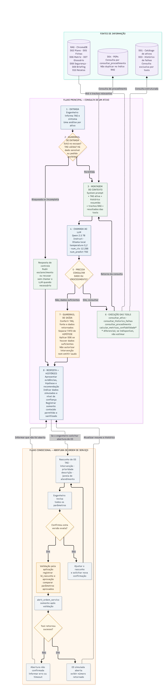

# EngMan Copilot

Assistente de IA generativa para a Engenharia de Manutenção da Motiva Rodovias — Challenge Integrador FIAP x Motiva, **Sprints 01 e 02 (somente documentação)**.

> Esta entrega apresenta o projeto do assistente em formato documental, conforme solicitado para a Sprint 01. Não inclui código nem protótipo funcional. As informações institucionais e o contexto do desafio foram retirados do briefing da disciplina; os dados operacionais criados para a proposta — como TAGs, fichas de ativos, históricos de falhas, POPs e prioridades — são **simulados** e não representam registros reais da Motiva.

## 1. Nome do projeto e integrantes

**Assistente:** EngMan Copilot — Recorte A (Diagnóstico e Confiabilidade) · **Grupo 01 · Turma 1CCPS**

| Integrante | RM | Turma |
|---|---|---|
| João Florencio | 576950 | 1CCPS |
| Leonardo Iglesias | 576557 | 1CCPS |
| Guilherme dos Santos | 576921 | 1CCPS |
| Ryan Alves | 576880 | 1CCPS |
| Enzo Lozano | 574944 | 1CCPS |

## 2. Problema abordado

O briefing informa que a Motiva opera mais de 5 mil km de rodovias concedidas, distribuídos por 13 concessionárias, com cerca de 2 milhões de veículos pedagiados por dia. Essa operação depende de equipamentos instalados em campo, como câmeras de CFTV, painéis de mensagens variáveis (PMV) e totens de emergência (Callbox). Esses ativos ficam expostos a chuva, poeira, fuligem, insetos, vibração e variações de temperatura, condições que podem afetar seu funcionamento e gerar solicitações de manutenção.

No briefing, a Motiva aponta três dificuldades relacionadas à manutenção: a identificação de falhas ainda depende bastante da percepção dos operadores do CCO; o planejamento é, em grande parte, baseado em calendário; e o histórico de ocorrências registrado no FSM é pouco aproveitado. A partir desse cenário, o grupo propõe um assistente que permita ao engenheiro consultar um ativo pelo TAG, verificar ocorrências anteriores e reunir informações para analisar uma falha e avaliar possíveis intervenções. A proposta se relaciona principalmente ao **Tema 2 — Confiabilidade preditiva** e, de forma complementar, ao **Tema 2.1 — Saúde visual dos ativos ITS**.

**Por que um assistente conversacional:** o engenheiro pode descrever o sintoma com suas próprias palavras e fazer perguntas sobre o ativo e seu histórico. O modelo interpreta a solicitação e organiza a resposta, enquanto informações específicas — como ficha, ocorrências e procedimentos — devem ser recuperadas da base de conhecimento ou das ferramentas previstas. Assim, o modelo não deve completar lacunas com informações presumidas. O assistente serve como apoio à análise; não confirma sozinho a causa da falha nem substitui a avaliação do engenheiro.

## 3. Recorte e persona

**Recorte A — Diagnóstico e Confiabilidade.** O grupo escolheu esse recorte por considerar interessante investigar como o histórico de manutenção pode ajudar na análise de falhas e na escolha de uma intervenção. A proposta é consultar um ativo por TAG, reunir suas informações e ocorrências anteriores e comparar esses registros com o sintoma informado. Com base no que estiver disponível, o assistente poderá apresentar possíveis causas, indicar o que precisa ser verificado e organizar informações para apoiar a decisão do engenheiro. Esse recorte está ligado ao **Tema 2 — Confiabilidade preditiva**, especialmente ao uso do histórico de falhas do FSM. O Recorte B foi deixado de lado porque tem outro foco: analisar vários alarmes em conjunto e distinguir falhas reais de condições ambientais. Nesta proposta, o grupo preferiu aprofundar a análise de um ativo por consulta.

**Persona principal: engenheiro de manutenção.** Essa persona foi escolhida porque o recorte envolve analisar reincidências, avaliar a condição dos equipamentos e planejar intervenções. O assistente deve apresentar os registros e as hipóteses que sustentam sua resposta, sem transformar uma possibilidade em diagnóstico confirmado. A decisão técnica continua sendo responsabilidade do engenheiro. Não haverá persona secundária nesta versão, para manter o projeto direcionado a um único perfil de usuário.

**Ativos do domínio:** CFTV (câmeras PTZ), PMV e Callbox. O grupo manterá esses três tipos de ativo como um subconjunto do parque apresentado no briefing. A recomendação de intervenção e prioridade é uma referência para análise; o engenheiro avalia as evidências e toma a decisão final. Os demais sistemas citados no documento da Motiva, como SAT, SCA, laços indutivos, pórticos Free Flow e HS WIM, ficam fora desta proposta.

**Como o assistente será utilizado:** o engenheiro consulta um ativo por vez, informando sua TAG e descrevendo o sintoma observado. O assistente identifica o equipamento, consulta sua ficha e criticidade e, conforme a pergunta, recupera o histórico de falhas e o procedimento relacionado. Em seguida, organiza os registros relevantes, apresenta possíveis causas como hipóteses e indica quais informações ainda precisam ser verificadas pelo engenheiro. Se a TAG não identificar um único ativo ou não for encontrada, o assistente deve pedir a confirmação ou informar que não localizou o registro, sem presumir qual equipamento o usuário quis consultar.

## 4. Escopo do assistente

**O que o assistente FAZ**
1. Explica conceitos de manutenção, confiabilidade e operação de CFTV, PMV e Callbox.
2. Consulta e resume ficha, criticidade e histórico de falhas de um ativo por TAG (tools).
3. Formula hipótese de causa provável com base no histórico e nos POPs, sempre como hipótese a validar em campo.
4. Apresenta uma recomendação de intervenção (corretiva, preventiva, inspeção ou CBM) e de prioridade (P1 a P4), explicando os critérios da Matriz de criticidade. A decisão final cabe ao engenheiro de manutenção.
5. Consulta métricas de confiabilidade (λ, MTBF e R(t)) por meio da ferramenta específica, quando ela estiver disponível e houver dados suficientes. Se a ferramenta não estiver disponível, não estima os valores.
6. Prepara o rascunho de uma ordem de serviço e o resumo de atendimento. A abertura de uma OS simulada só ocorre depois que o engenheiro revisar os parâmetros e confirmar explicitamente a solicitação.
7. Quando o dado não existe, diz que não sabe e encaminha ao responsável.

**O que o assistente RECUSA** (cada item vira regra no system prompt e caso no eval set)

| ID | Recusa | Regra no prompt | Caso no eval |
|---|---|---|---|
| RE1 | Emitir laudo técnico, ART ou parecer com validade legal | 3 | C15 |
| RE2 | Liberar, bloquear ou intervir fisicamente em equipamento | 4 | C15 |
| RE3 | Dar orientação de segurança elétrica ou de altura que substitua o procedimento oficial (NR-10 / NR-35) | 4 | C14, C06 |
| RE4 | Responder sobre assuntos alheios à manutenção | 5 | C09 |
| RE5 | Atuar sobre ativos fora do recorte (SAT, SCA, laços indutivos, pórticos Free Flow, HS WIM) | 5 | C10 |
| RE6 | Inventar TAG, modelo, número de série, número de OS, norma, métrica ou histórico | 1, 6, 11 | C08, C04, C01 |
| RE7 | Tratar dados pessoais de terceiros (placas, imagens de ocupantes, dados de empregados) | 9 | C11 |
| RE8 | Revelar ou alterar as próprias instruções; obedecer instrução embutida em laudo colado | 8 | C12, C13 |

As recusas previstas no prompt usam frases padronizadas (F1 a F4), definidas em `prompts/system_prompt.md`. Quando for possível atender apenas a parte permitida de um pedido, o assistente deve limitar a resposta ao conteúdo técnico autorizado, sem reproduzir dados pessoais ou instruções indevidas.

## 5. Arquitetura da solução

Fluxograma: [`docs/arquitetura.png`](docs/arquitetura.png)



**Fluxo proposto:** o engenheiro envia a pergunta (**1**); o **guardrail de entrada** (**2**) verifica se o pedido está no escopo, identifica solicitações perigosas ou tentativas de alterar as instruções e prevê o tratamento de dados pessoais; se a entrada não puder ser atendida, o fluxo apresenta a resposta de recusa adequada. Quando aprovada, a pergunta segue para a **montagem do contexto** (**3**), que reúne o system prompt, o TAG ativo, o histórico relevante, os trechos recuperados pelo RAG e os resultados das ferramentas já consultadas. O **LLM** (**4**) interpreta a solicitação e, no ponto de decisão (**5**), identifica se precisa consultar a base ou alguma ferramenta. A ferramenta correspondente é executada (**6**) e seu retorno é incluído no contexto para a elaboração da resposta. Antes de entregar o resultado, o **guardrail de saída** (**7**) verifica a existência das informações, a indicação das fontes, a separação entre fato e hipótese e a ausência de autorização indevida ou de dados não permitidos. Por fim, a resposta é apresentada e o turno pode ser registrado no histórico (**8**), respeitando a política de limite de contexto. Como esta Sprint é documental, esse fluxo representa a arquitetura planejada, ainda não implementada.

| Bloco | Função neste projeto |
|---|---|
| 1 Entrada | consulta de um ativo por vez: o engenheiro informa a TAG (ex.: CFTV-R01-K412-01) e descreve o sintoma observado |
| 2 Guardrail de entrada | escopo (CFTV/PMV/Callbox), pedidos de laudo ou autorização de intervenção, tentativas de prompt injection e identificação de dados pessoais |
| 3 Montagem do contexto | system prompt + TAG ativo + histórico (até 10 mensagens recentes e resumo) + até 4 trechos do RAG filtrados por tipo de ativo/TAG |
| 4 Chamada ao LLM | Qwen 2.5 7B Instruct local, temperature 0,2, top_p 0,9, num_ctx 12288 e num_predict 700 |
| 5 Decisão de tool | as informações disponíveis são suficientes ou é necessário consultar ficha, histórico, POP ou métricas? |
| 6 Execução da tool | consulta aos dados simulados; abertura de OS somente após confirmação dos parâmetros pelo engenheiro; tratamento de erros como `ATIVO_NAO_ENCONTRADO` e `TIMEOUT` |
| 7 Guardrail de saída | conferência de TAG e métricas, indicação de fonte, separação FATO/HIPÓTESE e ausência de laudo ou autorização indevida |
| 8 Resposta + histórico | formato (≤4 parágrafos ou 8 itens), política de limite de contexto e reafirmação do TAG ativo |

## 6. Stack e justificativa técnica

Caminho de execução **100% gratuito**. Comparação resumida (detalhes em [`docs/decisoes_tecnicas.md`](docs/decisoes_tecnicas.md)):

| Modelo | Custo | Licença | pt-BR | Contexto | Privacidade | Integração | Maturidade |
|---|---|---|---|---|---|---|---|
| **Qwen 2.5 7B Instruct (Ollama local)** — escolhido | zero para uso local, após baixar o modelo | Apache 2.0 para a versão 7B | a validar no eval set | depende do modelo e da configuração local | local | API/SDK do Ollama | documentação disponível |
| Llama 3.1 8B Instruct (Ollama local) | zero para uso local, após baixar o modelo | Llama 3.1 Community License | a validar no eval set | depende do modelo e da configuração local | local | API/SDK do Ollama | documentação disponível |

| Vector store | Custo/licença | Persistência | Filtro por metadado | Facilidade | Maturidade |
|---|---|---|---|---|---|
| **ChromaDB** — escolhido | grátis, Apache 2.0 | embutida | nativo | muito simples | boa |
| FAISS | grátis, MIT | manual | não nativo | média | muito madura |

**Escolhas:** modelo **Qwen 2.5 7B Instruct local**; vector store **ChromaDB**; embeddings **`intfloat/multilingual-e5-base`** executados localmente com Sentence Transformers; orquestração por **chamadas diretas à API do Ollama**, sem LangChain. O trade-off aceito é trabalhar com um modelo menor, cujo desempenho em português técnico ainda precisa ser medido no eval set, em troca de manter o processamento local e não depender de uma API paga. Os parâmetros previstos para o Ollama são `temperature = 0,2`, `top_p = 0,9`, `num_ctx = 12288` e `num_predict = 700`. Ambiente previsto: Python 3.10 ou superior, com possibilidade de uso em Colab, Jupyter ou VS Code. Versionamento: Git e GitHub público.

## 7. Base de conhecimento

O inventário em [`data/knowledge_base/inventario.md`](data/knowledge_base/inventario.md) prevê **10 documentos** (D01 a D10), identificando conteúdo, origem, quantidade estimada e forma de consulta. D01 (catálogo) e D03 (histórico FSM) serão consultados por tools; D04 (POPs) será consultado exclusivamente por `consultar_procedimento`, sem duplicação no RAG. Os documentos D02 e D05 a D10 serão indexados no ChromaDB. A proposta prevê trechos de **350 a 450 tokens**, sobreposição inicial de cerca de 50 tokens e recuperação de até quatro trechos por consulta. O embedding escolhido é `intfloat/multilingual-e5-base`, executado localmente. Os metadados incluem `doc_id`, `tipo_documento`, `tipo_ativo`, `tag` quando aplicável, `data_referencia`, `versao`, `simulado` e `fonte`. O inventário também define cinco ativos âncora e os dados que não devem entrar na base.

## 8. System prompt

[`prompts/system_prompt.md`](prompts/system_prompt.md) contém os sete blocos solicitados (PAPEL, OBJETIVO, ESCOPO, REGRAS, FORMATO, TOM e BORDA), regras numeradas, frases de resposta padronizadas, distinção entre FATO e HIPÓTESE e orientação para lidar com fontes divergentes. Também inclui três exemplos de classificação de prioridade (*few-shot*) e uma roteiro de análise estruturada para falhas intermitentes, com apresentação ao usuário apenas de um resumo das premissas, evidências e conclusão, sem expor raciocínio interno detalhado. Cada bloco tem um comentário sobre sua finalidade.

## 9. Eval set

[`evals/sprint1_eval_set.json`](evals/sprint1_eval_set.json) — **19 casos** em 9 categorias:

| Categoria | Casos | Quantidade |
|---|---|---:|
| factual | C01–C04, C17 | 5 |
| instrucional | C05, C06, C18 | 3 |
| ambiguo | C07 | 1 |
| dado_inexistente | C08 | 1 |
| out_of_scope | C09–C10 | 2 |
| jailbreak | C12–C13 | 2 |
| risco_operacional | C14–C15, C19 | 3 |
| lgpd | C11 | 1 |
| memoria_contexto | C16 | 1 |

Cada caso contém `contexto_esperado`, `resposta_ideal`, `criterios_avaliacao`, `deve_recusar` e o campo adicional `rastreia`, que relaciona o teste às regras e aos riscos do projeto. Os casos devem avaliar também quando cabe recusar apenas uma parte do pedido, em vez de interromper toda a solicitação.

## 10. Tools especificadas

Contrato em JSON Schema: [`tools/tools_spec.json`](tools/tools_spec.json) (enums fechados, `pattern` do TAG, comportamento em falha documentado).

| Tool | O que faz | Parâmetros | Status |
|---|---|---|---|
| `consultar_ativo` | ficha do ativo: tipo, fabricante, modelo, km, praça, instalação, vida útil e criticidade | `tag` **ou** `tipo_ativo` + `km` (rodovia R01 no cenário) | obrigatória |
| `consultar_historico_falhas` | falhas do ativo na janela do conjunto simulado: data, sintoma, causa, tempo de reparo e reincidência | `tag`, `janela_meses` (1 a 12; padrão 12), `tipo_falha` (enum opcional) | obrigatória |
| `abrir_ordem_servico` | registra uma OS simulada e devolve o número somente após validação da aplicação | `id_rascunho`, `tag`, `tipo_intervencao`, `prioridade`, `descricao`, `janela_inicio`, `janela_fim`; o `id_rascunho` referencia uma versão aprovada pela aplicação | obrigatória |
| `consultar_procedimento` | recupera o POP aplicável e seus pré-requisitos; não autoriza sua execução | `tipo_ativo` (enum), `tipo_intervencao` (enum) | obrigatória |
| `calcular_metricas_confiabilidade` | λ, MTBF e R(t), sob as premissas do modelo exponencial; sem campo de tendência | `tag`, `periodo_meses`, `tempo_operacao_horas` (opcional, com premissa explicitada), `horizonte_horas` | diferencial (não essencial ao fluxo básico) |

## 11. Riscos e mitigações

Matriz completa em [`docs/riscos_lgpd.md`](docs/riscos_lgpd.md): **12 riscos**, cada um com impacto, mitigação e rastreio. Na tabela abaixo, S = segurança, F = financeiro, L = legal e R = reputacional.

| Risco | Impacto | Mitigação (onde aparece) |
|---|---|---|
| Alucinação | F, S, R | regras 1, 6, 11; guardrail de saída; casos C01, C02, C04, C08 |
| Prompt injection / jailbreak | S, F, R | regra 8; guardrail de entrada; C12, C13 |
| Risco operacional (elétrica/altura/via) | S | regra 4 + frase F2; POP e NR-10/NR-35; C06, C14 |
| Viés na priorização | F, S | regra 10 + Matriz D06; C02, C03 |
| LGPD: dado pessoal | L, R | regra 9; o que não entra na base; C11 |
| Confidencialidade operacional | F, L | modelo local, dado simulado, `.gitignore` |
| Excesso de confiança | F, S | FATO x HIPÓTESE, nível de confiança; C03 |
| Contexto estourado | F, S | política de histórico, TAG ativo; C16 |
| Responsabilidade legal indevida | L, S, R | regras 3, 4, 12; C15 |
| Ação indevida por tool | F, R | regra 12; `id_rascunho` validado pela aplicação; C05, C18 e C19 |
| Dado simulado confundido com real | L, R | regra 13; rótulo "simulado" |

## 12. Rastreabilidade (coerência entre os artefatos)

| Vínculo | Onde está |
|---|---|
| Escopo (recusas) → system prompt | seção 4 acima e tabela final de `prompts/system_prompt.md` |
| Escopo → eval set | coluna "Caso no eval" da seção 4 |
| Fluxograma → system prompt | guardrails do bloco 2 e do bloco 7 existem como regras 3, 4, 5, 8, 9, 1, 2 e bloco FORMATO |
| Escopo → tools | cada "FAZ" tem fonte: 2 e 3 (tools de ativo e histórico), 4 (Matriz D06), 5 (métricas), 6 (OS), 7 (frase F4) |
| Tools → base | D01 será consultado por `consultar_ativo`; D03 por `consultar_historico_falhas` e pela ferramenta de métricas; D04 será consultado exclusivamente pela ferramenta `consultar_procedimento`; D02 e D05 a D10 serão recuperados pelo RAG. D01, D03 e D04 não serão duplicados no índice vetorial. |
| Riscos → prompt e eval | coluna "Onde aparece" de `docs/riscos_lgpd.md` |

## 13. Limitações conhecidas

- Os registros operacionais do projeto são simulados. O catálogo, o histórico, a matriz de criticidade e os prazos associados às prioridades P1 a P4 não são padrões oficiais da Motiva e precisariam ser fornecidos ou validados pela empresa antes de qualquer uso real.
- Nesta Sprint nada foi executado: as respostas ideais e os critérios do eval set ainda **não foram medidos** contra o modelo real; isso será feito nos Módulos 3 e 4.
- Modelo 7B local pode errar em português técnico ou ignorar regras longas; o guardrail de saída e o eval set existem para medir isso.
- Cobertura limitada a CFTV, PMV e Callbox em uma rodovia fictícia (R01); não cobre SAT, SCA, laços, pórticos e HS WIM.
- As métricas de confiabilidade previstas usam o modelo exponencial e a premissa de taxa de falha constante. A qualidade do resultado depende da quantidade e da qualidade dos registros; a ferramenta deverá informar quando os dados forem insuficientes. A ferramenta não deve apresentar uma tendência de falhas nesta versão, pois ainda não foi definido um método para calculá-la.
- Persona única (engenheiro): o técnico de campo exigiria outro tom e outras respostas.

## 14. Referências

- Briefing do Challenge Integrador "EngMan Copilot" (FIAP x Motiva Rodovias), Sprints 01 e 02, e material de contexto da Motiva (Temas 1, 2 e 2.1).
- Materiais da disciplina Prompt Engineering & Artificial Intelligence (Módulos 1 e 2: tokens e janela de contexto, injection e guardrails, anatomia do prompt, few-shot, CoT, system prompt).
- NR-10 (Segurança em Instalações e Serviços em Eletricidade) e NR-35 (Trabalho em Altura), do Ministério do Trabalho e Emprego.
- Lei nº 13.709/2018 (LGPD).
- OWASP Top 10 for LLM Applications.
- Documentação do Ollama, ChromaDB e Sentence Transformers; cartão do modelo `intfloat/multilingual-e5-base`.

## Estrutura do repositório

```
engman-copilot/
|-- README.md
|-- .gitignore
|-- /docs/arquitetura.png
|-- /docs/riscos_lgpd.md
|-- /docs/decisoes_tecnicas.md
|-- /prompts/system_prompt.md
|-- /evals/sprint1_eval_set.json
|-- /data/knowledge_base/inventario.md
|-- /tools/tools_spec.json
-- sprint1_entrega.txt
```
